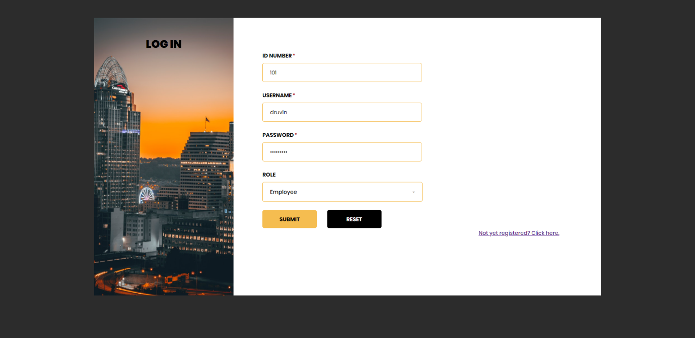
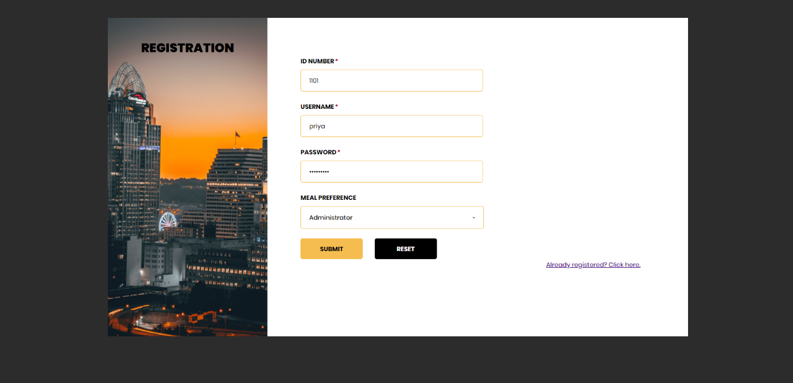
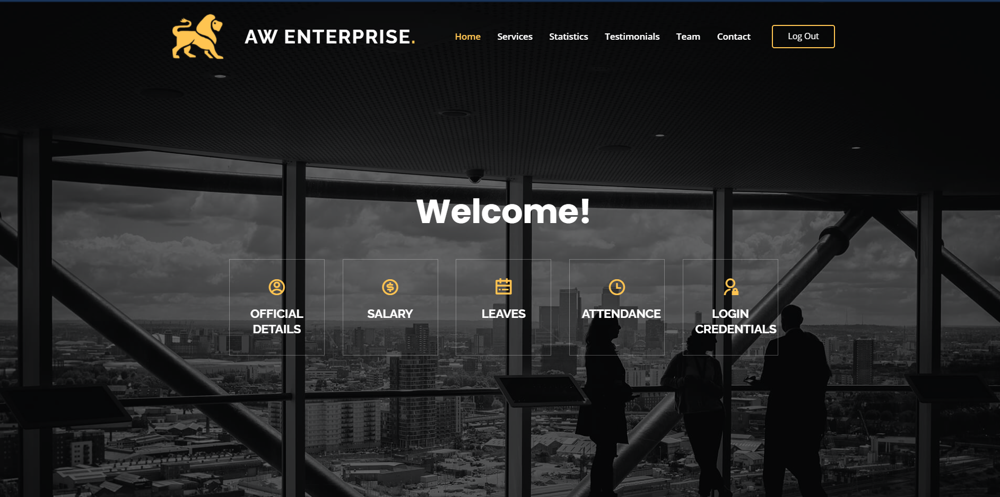
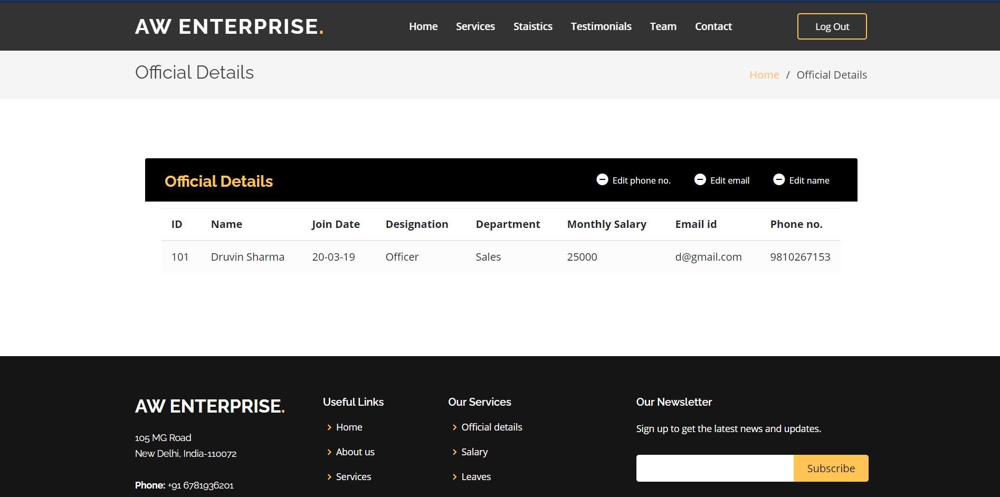
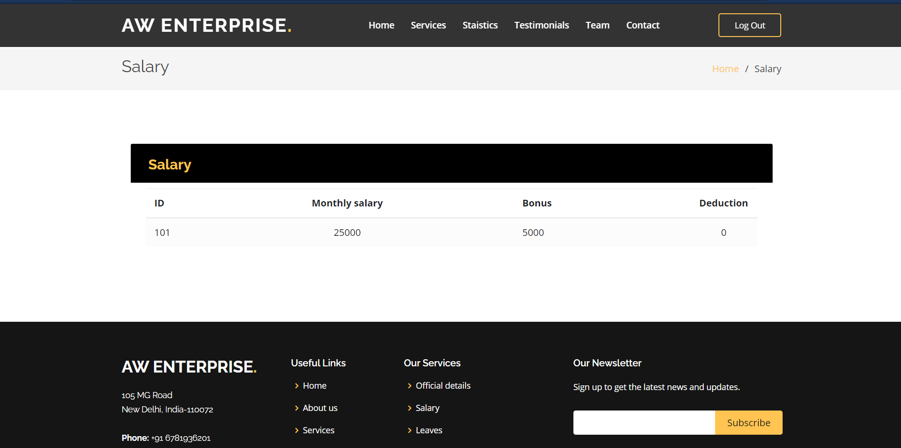
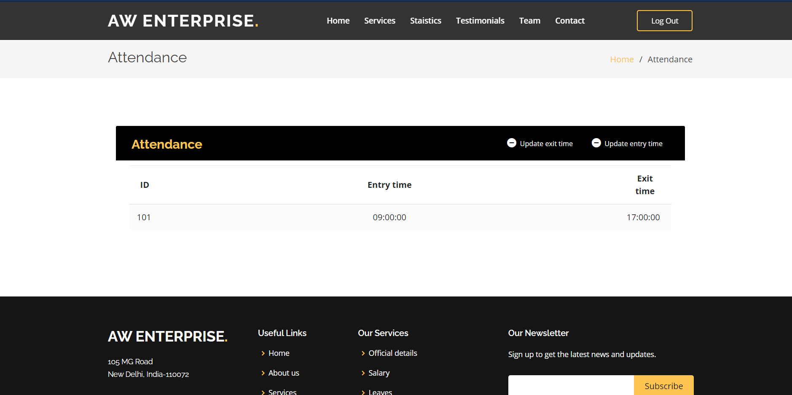
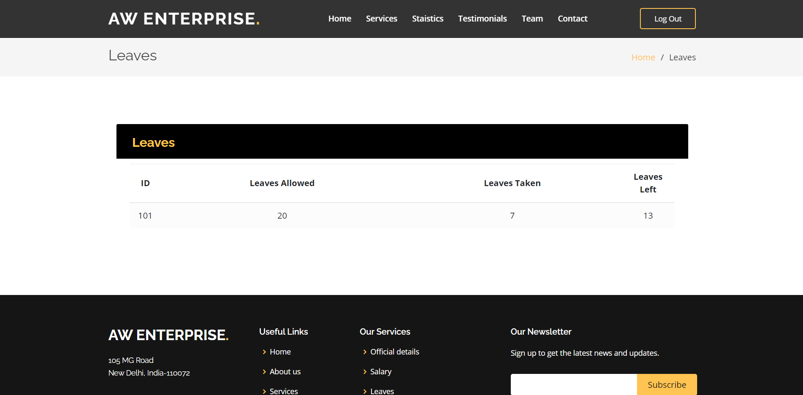
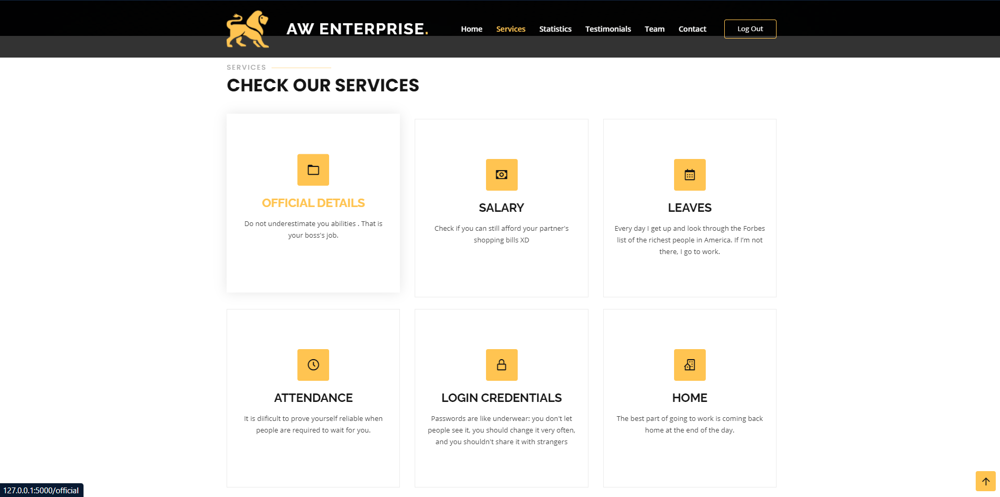
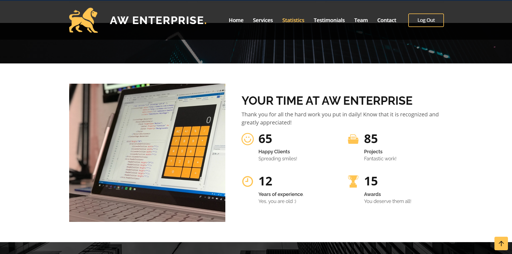
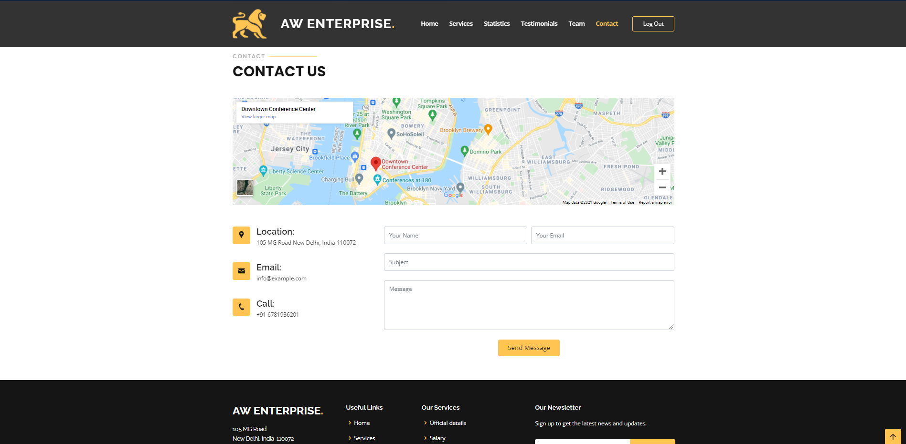

# Employee-Management-System
## Introduction
Usually, large companies and organizations have a vast army of human resources working under them. The Employee management system is a distributed application that helps us overcome the problems faced due to manual system. The objective of this project is to provide a comprehensive approach towards the management of employee information.

## Features
- This application aims to simplify the task of maintain the records of employees of a company in a well-designed database.
- Provides full functional reports to manage the company.
- It calculates the employee salary
- It helps in easy attendance marking.
- Easy calculation of various leaves in categories
- Computerized events and requests management
- Creates new users to the system according

## Demo
###Login Page

###Registration

###Home Page

###Admin Dashboard (Official Details)

###Salary Management

###Attendance Tracking

###Leave Management

###Services

###Statistics

###Contact Us

###Login Credentials Management

## Tech Stacks:
- Frontend: HTML, CSS and Bootstrap
- Backend: Flask, Python3
- Database: MySQL for Employee database

